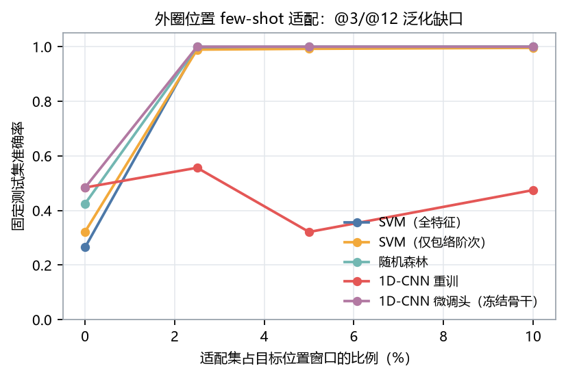
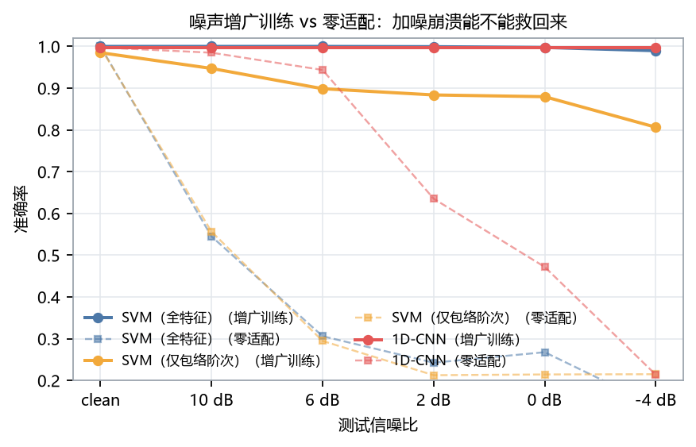

<div align="center">

# 轴承故障诊断，难在载荷之外
### CWRU 12 kHz 振动 → 时域/频域/包络阶次特征 + SVM/随机森林/1D-CNN → 四类部位与十类尺寸诊断


<p align="center">
  
</p>

</div>

---

给做 PHM / 设备运维算法的人：这是一套可复现的 CWRU 轴承诊断基准，输入一段驱动端振动，输出故障部位（正常/内圈/外圈/滚动体）与损伤尺寸（0.007″/0.014″/0.021″/未见 0.028″），并把"跨载荷、跨尺寸、跨位置、加噪"四种分布偏移拆开评测。**最关键的结论是：这个数据集在同工况内已经饱和，4 分类 100% 不能证明方法好；真正的差别出现在故障位置和信噪比上。**

**先看这 9 件事：**

1. **同工况已经饱和**：时间块划分下 SVM 1.000、RF 0.9998、CNN 0.9985；换成有泄漏的随机切窗，差值是 0.0000——不是没泄漏，是任务太容易，泄漏抬不动（见报告 §3.1）。
2. **跨载荷几乎不掉点，缺口全在一个异常件上**：4 分类留一载荷 SVM 0.924 / RF 0.930 / CNN 0.936；剔除 `217.mat` 后四折均值 SVM 0.987 / RF 0.990 / CNN 1.000（§3.2、§3.11）。它作测试样本是 −25 点灾难，作**训练**样本却是小剂量的分布桥接：3→0 迁移 0.852→0.986，且 117 窗的剂量好于全量 478 窗（§3.11-B3）。
3. **只留 26 维包络阶次特征，跨载荷 0.993，高于 48 维全特征的 0.924——但只对 SVM 成立**：时域幅值特征把异常文件从内圈推成滚动体，阶次特征不受影响；RF 正相反（时域 0.959 最强、仅包络 0.907 最弱）。选特征要连模型一起选（§3.3、§3.13）。
4. **位置泛化是真正的失效模式，但 48 个目标窗口就能修掉**：零样本（训练 6 点钟 → 测试 3 点/12 点）SVM 0.266 / RF 0.423 / CNN 0.485；给每个目标文件 3 个窗口做适配后，特征模型全部回到 0.99+——但 CNN 重训救不动，要冻结骨干微调头（§3.6、§3.10）。
5. **加噪崩溃是训练分布问题，不是特征方法问题**：零适配时 10 dB 特征模型 0.545、CNN 0.985；噪声增广训练后全特征 SVM 10 dB 1.000、−4 dB 0.990，比 CNN 还稳（§3.7、§3.9）。
6. **端到端模型不外推损伤尺寸**：未见程度 0.028″ 上 CNN 全判 IR（0.500）、RF 0.493，只有 SVM 0.874 有部分外推能力（§3.8）。
7. **（v1.3）特征级域适应在 N1 上有效，与涡扇 RUL 的负迁移构成判别式**：CORAL 二阶协方差对齐把 0→3 从 0.7335 抬到 0.9030、1→3 从 0.7395 抬到 0.9078；剔掉 217 后无净收益，KMM 一阶加权无效，few-shot 每类 5 窗仍最强（0.9945）。N1 的偏移在边际协方差，N2 的在条件映射（§3.14）。
8. **（v1.3）白噪增广几乎不跨噪声族，混合族增广是免费保险**：0 dB 下白噪增广对白噪 +72.2 点，对有色只有 +3.2、对脉冲只有 +6.5；逐窗重抽与固定副本在 0 dB 以上逐位相同（§5.3 的公平性质疑被证伪）；三族混训后 0 dB 全部 ≥0.990 且白噪只掉 0.1 点（§3.15）。
9. **（v1.3）"217 小剂量最优"成立但峰值是 k=50–75，不是 117**：0HP 上 0.9907→全量 0.9483 反噬、2HP 完全不掉；k≥50 五个随机子集逐位一致；等量上采样全平（不是数据量），借真实同尺寸文件在 1/2HP 更优但 0HP 上异常件仍最强。学习曲线：同工况 2% 数据就 0.996，**跨载荷加数据无收益、RF 反而单调变差**（§3.16）。

---

## 数据

| 数据集 | 角色 | 许可 | 位置 |
|---|---|---|---|
| CWRU Bearing Data Center（12 kHz 驱动端） | 主数据集，64 文件 / 208 MB | 官方声明可用于研究，需引用来源 | `D:\项目\02_数据集\01_国际公开集\CWRU_轴承\raw\`（`scripts/00_download_data.py` 可一键拉齐） |
| 主线子集 | 4 类 × 4 载荷，40 文件 → 6246 个 2048 点窗口 | 同上 | `configs/cwru_manifest.csv` 的 `role=main` |
| 外圈位置子集 | @3/@12 点 × 2 尺寸 × 4 载荷，16 文件 | 同上 | `role=position` |
| 未见于训练的程度 | 0.028″ × 内圈/滚动体 × 4 载荷，8 文件 | 同上 | `role=severity` |

**评测协议**：所有结论按"整条记录/整个载荷"分组，重叠窗口绝不跨训练测试；同工况用记录内时间块划分并留 1 个块作隔离带。报告里同时给"随机切窗（有泄漏）"的数字作对照，标注为不可用于比较。

## Results

4 分类（正常/内圈/外圈/滚动体），SVM 与 RF 为 5 个随机种子均值±标准差，CNN 为 1–2 个种子：

| 模型 | 同工况（时间块） | 跨载荷（4 折） | 跨载荷（剔 217） | 未见程度 0.028″ | 未见位置 | 加噪 10 dB | 加噪 10 dB（增广后） |
|---|---|---|---|---|---|---|---|
| SVM（48 维特征） | 1.0000 | 0.924±0.105 | **0.987** | **0.874** | 0.266 | 0.545 | **1.000** |
| 随机森林 | 0.9998 | 0.930±0.122 | 0.990 | 0.493 | 0.423 | — | — |
| 1D-CNN（原始波形） | 0.9985 | 0.936±0.109 | 1.000 | 0.500 | 0.485 | **0.985** | 0.997 |

特征消融（留一载荷）：SVM 时域 0.829 / 时域+频域 0.910 / 全特征 0.924 / **仅包络阶次 0.993**；RF 正相反——时域 0.959 最强、仅包络 0.907 最弱（§3.13）。时间块口径下所有组 ≥ 0.97，组间差异只在跨载荷才拉开。

10 分类（部位 × 尺寸）：同工况 0.998–1.000；留一载荷 SVM 0.907（类型正确率 0.921）、RF 0.948（0.949）、CNN 0.893（0.937）；剔 217 后 0.973 / 0.997 / 0.949。序数口径（§3.13）：尺寸误差从不跨档（≤1 档比例 1.0000），部位判对后尺寸准确率 0.986–0.999——LOO 的错误几乎全是 217 的部位错误。

载荷探针（§3.12）：仅包络特征仍能以 77% 解码载荷标签（机会 25%）——阶次化消掉的是频率缩放，幅值/调制结构仍编码载荷；单源迁移矩阵显示 0→3 = 0.48、3→0 = 0.99 的强不对称。

位置 few-shot（给目标位置文件各 3 个窗口做适配，测试集固定 1675 窗）：SVM 0.265→**0.998**、RF 0.425→0.999、CNN 重训不动（0.32–0.56）、**CNN 冻结骨干微调头 1.000**。

<p align="center">
  
</p>

上图：横轴是适配窗口占目标位置文件的比例。特征模型 48 个窗口就饱和；CNN 重训（红线）全程不动，冻结骨干微调头（紫线）从最小档就是 1.000。

<p align="center">
  
</p>

上图：虚线为零适配（干净训练、带噪测试），实线为增广训练。同一个 SVM，崩溃与否只取决于训练分布覆盖。

<p align="center">
  
</p>

上图：特征不是越多越好。仅包络阶次（26 维）比全特征（48 维）高 7 个点，因为时域幅值特征在跨工况时是负担。

<p align="center">
  
</p>

上图：左为"训练 3 档尺寸 → 测试 0.028″"，SVM 0.874、RF 0.493（树模型外推塌陷）；右为"训练 6 点钟 → 测试 3/12 点钟"，超过一半外圈故障被误判成滚动体。

### v1.3 深化（§3.14–§3.16）

| 实验 | 关键数字 |
|---|---|
| 域适应（CORAL / KMM / few-shot） | 0→3：0.7335 → **0.9030**（CORAL）→ **0.9945**（每类 5 窗）；KMM 权重 std 0.69–0.88 但准确率逐位不变；剔 217 后各格 ≥0.988，CORAL 不再有净收益 |
| 噪声族与增广公平性 | 0 dB 白噪增广：白噪 0.275→0.998、有色 0.828→0.859、脉冲 0.214→0.279；三族混训 0.997 / **0.999** / **0.990**；逐窗重抽 − 固定副本 = 0.0 点（0 dB 以上） |
| 217 剂量与样本效率 | 峰值 k=50（0HP 0.9907）、k=478 反噬到 0.9483；等量上采样全平 0.8991；借真实样本 1HP 0.9987；跨载荷 LOO 学习曲线 RF 0.739→0.719 |

三个新模块 `adaptation.py` / `noise.py` / `sample_efficiency.py`，4 个脚本（15–18），47 项新单测（全库 77），3 张新图与 3 份 JSON。全部数字见 `results/v13_summary_tables.md`。

## Quick start

```bash
git clone <this-repo> && cd CWRU轴承故障诊断-N1
pip install -r requirements.txt

pytest tests -q                       # 77 项，纯合成信号，不依赖数据集
python scripts/00_download_data.py    # 64 文件 / 208 MB，官方直链
bash run_all.sh                       # 全流程 00–18，约 60 分钟（CPU，含 3 次 CNN 训练）
```

核心产出：报告 `reports/基准评测报告-N1.md`、指标 `results/metrics/*.json`、图 `results/figures/*.png`。

单文件诊断：

```bash
python tools/predict.py 105.mat
# 输出：转速/理论故障频率、逐窗投票、包络证据（实测值 vs 该类训练均值，z 分数）
```

## Bring your own data

当前只支持 CWRU `.mat`（MATLAB v5，键名 `X###_DE_time` / `X###RPM`）。换成自己的台架数据，最短路径是：

1. 把数据整理成"一条记录一个文件"，并在 `configs/cwru_manifest.csv` 里登记 `label / load_hp / severity / position / rpm`；
2. 改 `src/cwru_diag/io.py::load_record` 的读取部分（返回 `de` 数组、`rpm`、`fs`）；
3. 若轴承型号不同，改 `configs/config.yaml` 的 `bearing` 几何（滚动体数、球径、节径、接触角），故障阶次会自动重算。

特征与模型层不需要改：`pipeline.features_for` 只依赖波形、采样率、转速。

## How it works

```
原始振动 (12 kHz)
  ├─ 2048 点切窗（50% 重叠）→ 6246 窗
  ├─ 时域 12 维（RMS/峭度/峰值因子…）
  ├─ 频域 10 维（谱质心/谱熵/子带能量）
  ├─ 包络阶次 26 维（Hilbert 包络 → FFT → 实测转速换算 BPFO/BPFI/2BSF/FTF 的 1–3 次谐波带内峰值）
  └─ 原始波形 → 1D-CNN（3 个卷积块 + GAP）
        ↓
   四类部位 / 十类尺寸
```

关键设计只有一条：**故障特征频率随转速缩放，所以用实测 RPM 把频率换算成阶次再取峰**。这是跨载荷不掉点的原因，也是本仓库与"直接取固定频带能量"的做法最大的区别。细节见报告 §2。

## Reproduce

```bash
python scripts/01_eda.py --roles main                  # 波形/包络谱/特征空间
python scripts/02_train_classical.py                    # SVM/RF，两种划分口径
python scripts/03_train_cnn.py                          # 1D-CNN 同工况
python scripts/04_cross_load.py --cnn-seeds 1 --cnn-epochs 20   # 留一载荷 + 单源 0→3
python scripts/05_ablation_position_severity.py         # 消融 / 未见程度 / 未见位置
python scripts/07_severity_10class.py                   # 类型×程度 10 分类
python scripts/08_noise_robustness.py                   # 加噪（复用 03 的权重）
python scripts/09_cnn_ood.py                            # 深化：CNN 跨载荷/未见程度/未见位置/10 分类
python scripts/10_noise_aug.py                          # 深化：噪声增广训练 vs 零适配
python scripts/11_position_fewshot.py                   # 深化：位置 few-shot 适配曲线
python scripts/12_sensitivity_217.py                    # v1.2：217 双口径 + 剂量去混杂
python scripts/13_transfer_matrix.py                    # v1.2：迁移矩阵 + 载荷探针
python scripts/14_10class_ordinal.py                    # v1.2：序数口径 + 消融×协议
python scripts/15_domain_adaptation.py                  # v1.3：CORAL / KMM / few-shot 域适应
python scripts/16_noise_families.py                     # v1.3：白 / 有色 / 脉冲噪声族
python scripts/17_dose_learning_curve.py                # v1.3：217 剂量曲线 + 学习曲线
python scripts/06_make_figures.py                       # 汇总图
python scripts/18_summary_v13.py                        # v1.3 汇总表
```

## Layout

```
src/cwru_diag/     可复用模块：io / kinematics / segmentation / features / models / pipeline / evaluation
                   + v1.2 ordinal / diagnostics + v1.3 adaptation / noise / sample_efficiency
scripts/           00–18 分析流水线（每个脚本一个可独立运行的实验；09–11 v1.1、12–14 v1.2、15–17 v1.3 深化）
configs/           config.yaml + cwru_manifest.csv（64 行官方文件映射）
tests/             77 项单测（运动学、包络阶次物理正确性、划分无泄漏、噪声增广口径、序数指标、
                   异常件诊断、域适应退化性、三类噪声 SNR 精确性、剂量/分层抽样语义）
reports/           基准评测报告（结论）
results/metrics/   全部数字的 JSON 出处（报告可逐条溯源）
results/figures/   全量产出图
docs/figures/      README 展示用精选图
tools/predict.py   单文件诊断演示
```

## 边界与负结果

1. **217.mat 是官方数据里的异常件**：官方列在 3 HP 的 `IR021_3`，但转速 1752 rpm（同组 1721/1728）、时长 41 s（其余 10 s）、RMS 0.760 高于全部内圈文件、峭度 3.50 低于全部内圈文件、包络谱 BPFO 主导。保留并在报告里给两套数字，不静默剔除。
2. **位置 few-shot 是"校准"不是"冷启动"**：适配窗口与测试窗口来自同一批文件（前 10% 适配、其后测试，窗口 50% 重叠）。它回答"现场已就位、采 1–2 秒数据做校准"的场景；对全新设备的冷启动泛化仍需跨设备实验。另外 CNN 重训救不动 few-shot（样本被主线淹没），必须冻结骨干微调头。
3. **（v1.3 已收紧）噪声增广的收益不跨噪声族**：§3.9 只测了高斯白噪；v1.3 §3.15 补上有色噪/脉冲噪后，白噪增广对这两族只有 +3.2 / +6.5 点（同族 +72.2）。SVM 固定副本 vs CNN 逐窗重抽的公平性差异已单独证伪（0 dB 以上逐位相同）。三族噪声仍是合成，未接真实台架干扰。
4. **包络阶次特征依赖转速**：所有实验都用 `.mat` 里的实测 RPM；转速未知或打滑时优势消失。变转速工况需要角域重采样，本项目未覆盖。
5. **同工况 100% 不是成绩**：随机切窗与时间块划分的差值约 0，属天花板效应；任何在此数据集上报 99%+ 的工作都应交代划分口径。
6. **未做跨设备迁移**（CWRU → Paderborn/JNU），这是比跨载荷更真实的域偏移；未见程度只测了 0.028″ 一个外推点。
7. ~~**v1.2 的剂量曲线只有一个点**~~ → **v1.3 已补完整曲线**：峰值 k=50–75 而非 117，k≥50 五个随机子集逐位一致，等量上采样全平；借真实同尺寸 IR021 文件在 1/2HP 能替代异常件，但 0HP 上 217 仍最强。载荷探针仍只用 RF(n=200)，是可解码性下界不是信息论度量。
8. **v1.3 口径限定**：域适应是直推式（对齐拟合用目标域无标签特征）；CNN 三配置各 1 个 seed；借真实样本池只有 234–235 窗、k 超池时有放回；`borrow_real` 是跨载荷借样本，不等于 §5.5 的跨设备迁移。CORAL 变换只作用于源域，shrink 是样本层面凸组合（四个实现坑都写进单测，见报告 §3.14）。

## Going deeper

<details>
<summary>实现层踩过的两个坑（会改变结论）</summary>

1. **包络带内无 bin → 特征恒 0**：1024 点窗时 Δf=11.7 Hz，而 BPFI 的 ±2% 只有 ±3.2 Hz，多个文件 `env_bpfi_h1_snr` 恒为 0，看起来像"这批数据没有内圈特征"。改为"带宽 ≥ 1 个频率分辨单元"并把窗长提到 2048 后消失。
2. **特征缓存键不含数据集规模**：先跑主线（6246 窗）再跑全量（9063 窗）会读到旧缓存；维度恰好相同时会静默出错。已在缓存键里加入窗口数。

</details>

<details>
<summary>数据文件映射的三个坑</summary>

- `IR021_3` 是 **217.mat**（不是 212.mat，212 也在服务器上但表格不指向它）；
- 外圈 12 点 0.007″ 的 1 HP 是 **158.mat**（157 未被列出）；
- `OR014@3`、`OR014@12`、全部 `OR028` 官方缺失（表格里是 `*`）。

</details>

## Citation & licence

```bibtex
@software{cwru_bearing_diag_2026,
  author = {博远科研},
  title  = {CWRU 轴承故障智能诊断：包络阶次特征与跨载荷泛化},
  year   = {2026},
  url    = {https://github.com/ilo-love7/cwru-bearing-diagnosis}
}
```

若使用数据，请引用 Randall, R.B. & Antoni, J., *Rolling element bearing diagnostics—A tutorial*, MSSP 25(2):485–520, 2011（DOI 10.1016/j.ymssp.2010.07.017）。

MIT License · 数据集版权归 Case Western Reserve University，按其官方声明用于研究。
