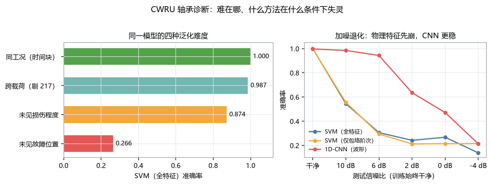
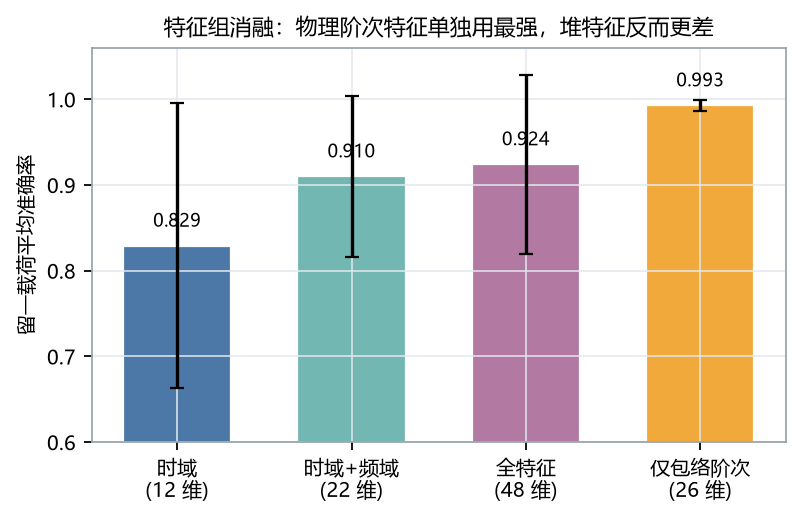
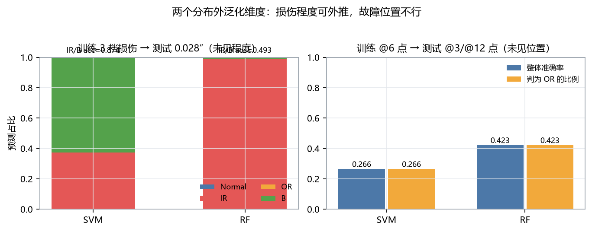

<div align="center">

# 轴承故障诊断，难在载荷之外
### CWRU 12 kHz 振动 → 时域/频域/包络阶次特征 + SVM/随机森林/1D-CNN → 四类部位与十类尺寸诊断


<p align="center">
  
</p>

</div>

---

给做 PHM / 设备运维算法的人：这是一套可复现的 CWRU 轴承诊断基准，输入一段驱动端振动，输出故障部位（正常/内圈/外圈/滚动体）与损伤尺寸（0.007″/0.014″/0.021″/未见 0.028″），并把"跨载荷、跨尺寸、跨位置、加噪"四种分布偏移拆开评测。**最关键的结论是：这个数据集在同工况内已经饱和，4 分类 100% 不能证明方法好；真正的差别出现在故障位置和信噪比上。**

**先看这 5 件事：**

1. **同工况已经饱和**：时间块划分下 SVM 1.000、RF 0.9998、CNN 0.9985；换成有泄漏的随机切窗，差值是 0.0000——不是没泄漏，是任务太容易，泄漏抬不动（见报告 §3.1）。
2. **跨载荷几乎不掉点**：4 分类留一载荷 SVM 0.924 / RF 0.930 / CNN 0.937；剔除一个官方异常文件后 SVM 0.987（§3.2）。
3. **只留 26 维包络阶次特征，跨载荷 0.993，高于 48 维全特征的 0.924**：时域幅值特征把异常文件从内圈推成滚动体，阶次特征不受影响（§3.3）。
4. **位置泛化是真正的失效模式**：训练 6 点钟外圈、测试 3 点/12 点，SVM 只剩 0.266、RF 0.423 能判对外圈——同一模型跨载荷是 0.99（§3.6）。
5. **加噪时物理特征先崩**：10 dB 下特征模型 0.545，CNN 0.985；机制是特征分布整体漂移（谱熵 0.849→0.924），不是信号被淹没（§3.7）。

---

## 数据

| 数据集 | 角色 | 许可 | 位置 |
|---|---|---|---|
| CWRU Bearing Data Center（12 kHz 驱动端） | 主数据集，64 文件 / 208 MB | 官方声明可用于研究，需引用来源 | `D:\项目\02_数据集\01_国际公开集\CWRU_轴承\raw\`（`scripts/00_download_data.py` 可一键拉齐） |
| 主线子集 | 4 类 × 4 载荷，40 文件 → 6246 个 2048 点窗口 | 同上 | `configs/cwru_manifest.csv` 的 `role=main` |
| 外圈位置子集 | @3/@12 点 × 2 尺寸 × 4 载荷，16 文件 | 同上 | `role=position` |
| 未见于训练的程度 | 0.028″ × 内圈/滚动体 × 4 载荷，8 文件 | 同上 | `role=severity` |

**评测协议**：所有结论按"整条记录/整个载荷"分组，重叠窗口绝不跨训练测试；同工况用记录内时间块划分并留 1 个块作隔离带。报告里同时给"随机切窗（有泄漏）"的数字作对照，标注为不可用于比较。

## Results

4 分类（正常/内圈/外圈/滚动体），SVM 与 RF 为 5 个随机种子均值±标准差，CNN 为 2–3 个种子：

| 模型 | 同工况（时间块） | 跨载荷（4 折） | 跨载荷（剔 217） | 未见位置 | 加噪 10 dB |
|---|---|---|---|---|---|
| SVM（48 维特征） | 1.0000 | 0.924±0.105 | **0.987** | 0.266 | 0.545 |
| 随机森林 | 0.9998 | 0.930±0.122 | — | 0.423 | — |
| 1D-CNN（原始波形） | 0.9985 | 0.937±0.109 | — | — | **0.985** |

特征消融（留一载荷，SVM）：时域 0.829 / 时域+频域 0.910 / 全特征 0.924 / **仅包络阶次 0.993**。

10 分类（部位 × 尺寸）：同工况 0.998–1.000；留一载荷 SVM 0.907（类型正确率 0.921）、RF 0.948（0.949）；剔 217 后 0.973 / 0.997。

<p align="center">
  
</p>

上图：特征不是越多越好。仅包络阶次（26 维）比全特征（48 维）高 7 个点，因为时域幅值特征在跨工况时是负担。

<p align="center">
  
</p>

上图：左为"训练 3 档尺寸 → 测试 0.028″"，SVM 0.874、RF 0.493（树模型外推塌陷）；右为"训练 6 点钟 → 测试 3/12 点钟"，超过一半外圈故障被误判成滚动体。

## Quick start

```bash
git clone <this-repo> && cd CWRU轴承故障诊断-N1
pip install -r requirements.txt

pytest tests -q                       # 16 项，纯合成信号，不依赖数据集
python scripts/00_download_data.py    # 64 文件 / 208 MB，官方直链
bash run_all.sh                       # 全流程，约 40 分钟（CPU）
```

核心产出：报告 `reports/基准评测报告-N1.md`、指标 `results/metrics/*.json`、图 `results/figures/*.png`。

单文件诊断：

```bash
python tools/predict.py 105.mat
# 输出：转速/理论故障频率、逐窗投票、包络证据（实测值 vs 该类训练均值，z 分数）
```

## Bring your own data

当前只支持 CWRU `.mat`（MATLAB v5，键名 `X###_DE_time` / `X###RPM`）。换成自己的台架数据，最短路径是：

1. 把数据整理成"一条记录一个文件"，并在 `configs/cwru_manifest.csv` 里登记 `label / load_hp / severity / position / rpm`；
2. 改 `src/cwru_diag/io.py::load_record` 的读取部分（返回 `de` 数组、`rpm`、`fs`）；
3. 若轴承型号不同，改 `configs/config.yaml` 的 `bearing` 几何（滚动体数、球径、节径、接触角），故障阶次会自动重算。

特征与模型层不需要改：`pipeline.features_for` 只依赖波形、采样率、转速。

## How it works

```
原始振动 (12 kHz)
  ├─ 2048 点切窗（50% 重叠）→ 6246 窗
  ├─ 时域 12 维（RMS/峭度/峰值因子…）
  ├─ 频域 10 维（谱质心/谱熵/子带能量）
  ├─ 包络阶次 26 维（Hilbert 包络 → FFT → 实测转速换算 BPFO/BPFI/2BSF/FTF 的 1–3 次谐波带内峰值）
  └─ 原始波形 → 1D-CNN（3 个卷积块 + GAP）
        ↓
   四类部位 / 十类尺寸
```

关键设计只有一条：**故障特征频率随转速缩放，所以用实测 RPM 把频率换算成阶次再取峰**。这是跨载荷不掉点的原因，也是本仓库与"直接取固定频带能量"的做法最大的区别。细节见报告 §2。

## Reproduce

```bash
python scripts/01_eda.py --roles main                  # 波形/包络谱/特征空间
python scripts/02_train_classical.py                    # SVM/RF，两种划分口径
python scripts/03_train_cnn.py                          # 1D-CNN 同工况
python scripts/04_cross_load.py --cnn-seeds 1 --cnn-epochs 20   # 留一载荷 + 单源 0→3
python scripts/05_ablation_position_severity.py         # 消融 / 未见程度 / 未见位置
python scripts/07_severity_10class.py                   # 类型×程度 10 分类
python scripts/08_noise_robustness.py                   # 加噪（复用 03 的权重）
python scripts/06_make_figures.py                       # 汇总图
```

## Layout

```
src/cwru_diag/     可复用模块：io / kinematics / segmentation / features / models / pipeline / evaluation
scripts/           00–08 分析流水线（每个脚本一个可独立运行的实验）
configs/           config.yaml + cwru_manifest.csv（64 行官方文件映射）
tests/             16 项单测（运动学恒等式、包络阶次物理正确性、划分无泄漏）
reports/           基准评测报告（结论）
results/metrics/   全部数字的 JSON 出处（报告可逐条溯源）
results/figures/   全量产出图
docs/figures/      README 展示用精选图
tools/predict.py   单文件诊断演示
```

## 边界与负结果

1. **217.mat 是官方数据里的异常件**：官方列在 3 HP 的 `IR021_3`，但转速 1752 rpm（同组 1721/1728）、时长 41 s（其余 10 s）、RMS 0.760 高于全部内圈文件、峭度 3.50 低于全部内圈文件、包络谱 BPFO 主导。保留并在报告里给两套数字，不静默剔除。
2. **位置泛化的结论只在"单方向训练"下成立**：训练集只有 6 点钟方向；混入少量 3/12 点样本会改变结论，本项目未做该消融。
3. **加噪实验没有做噪声增广**：测的是"不适配会怎样"，不能据此否定特征方法。
4. **包络阶次特征依赖转速**：所有实验都用 `.mat` 里的实测 RPM；转速未知或打滑时优势消失。变转速工况需要角域重采样，本项目未覆盖。
5. **同工况 100% 不是成绩**：随机切窗与时间块划分的差值约 0，属天花板效应；任何在此数据集上报 99%+ 的工作都应交代划分口径。
6. **未做跨设备迁移**（CWRU → Paderborn/JNU），也未在位置/程度口径上跑 CNN。

## Going deeper

<details>
<summary>实现层踩过的两个坑（会改变结论）</summary>

1. **包络带内无 bin → 特征恒 0**：1024 点窗时 Δf=11.7 Hz，而 BPFI 的 ±2% 只有 ±3.2 Hz，多个文件 `env_bpfi_h1_snr` 恒为 0，看起来像"这批数据没有内圈特征"。改为"带宽 ≥ 1 个频率分辨单元"并把窗长提到 2048 后消失。
2. **特征缓存键不含数据集规模**：先跑主线（6246 窗）再跑全量（9063 窗）会读到旧缓存；维度恰好相同时会静默出错。已在缓存键里加入窗口数。

</details>

<details>
<summary>数据文件映射的三个坑</summary>

- `IR021_3` 是 **217.mat**（不是 212.mat，212 也在服务器上但表格不指向它）；
- 外圈 12 点 0.007″ 的 1 HP 是 **158.mat**（157 未被列出）；
- `OR014@3`、`OR014@12`、全部 `OR028` 官方缺失（表格里是 `*`）。

</details>

## Citation & licence

```bibtex
@software{cwru_bearing_diag_2026,
  author = {博远科研},
  title  = {CWRU 轴承故障智能诊断：包络阶次特征与跨载荷泛化},
  year   = {2026},
  url    = {https://github.com/ilo-love7/cwru-bearing-diagnosis}
}
```

若使用数据，请引用 Randall, R.B. & Antoni, J., *Rolling element bearing diagnostics—A tutorial*, MSSP 25(2):485–520, 2011（DOI 10.1016/j.ymssp.2010.07.017）。

MIT License · 数据集版权归 Case Western Reserve University，按其官方声明用于研究。
