# CWRU 滚动轴承故障诊断 · 基准评测报告（N1）

> 版本 v1.2 ｜ 2026-11-07 初版，2026-11-11 v1.2 深化 ｜ 数据：CWRU 12 kHz 驱动端 ｜ 代码：`01_在研项目/CWRU轴承故障诊断-N1`
> 全部数字可在 `results/metrics/*.json` 逐条溯源；图在 `results/figures/`。

---

## 摘要

在 CWRU 四类轴承状态（正常/内圈/外圈/滚动体）上，用同一套 48 维「时域 + 频域 + 包络阶次」特征和原始波形 1D-CNN，跑完了同工况、跨载荷、跨损伤程度、跨故障位置、加噪五组口径；v1.1 补了三组深化实验（CNN 分布外对照 §3.8、噪声增广 §3.9、位置 few-shot §3.10）；v1.2 又补了 217.mat 双口径系统化（§3.11）、4×4 迁移矩阵与载荷探针（§3.12）、10 分类序数口径与消融×协议（§3.13）。结论与预期不同，按重要性排列：

1. **这个基准在同工况内已经饱和。** 时间块划分下 SVM 1.000、随机森林 0.9998、1D-CNN 0.9985；再换成有泄漏的随机切窗，也还是 1.000（差 0.0000）。也就是说，文献里大量 99%+ 的报数在这个数据集上**没有区分方法的能力**——它测的是"能不能分开这四类"，而不是"模型好不好"。
2. **跨载荷几乎不掉点，4 分类 LOO 平均 0.924–0.937；剔除一个异常文件后四折均值 SVM 0.987 / RF 0.990 / CNN 1.000（§3.11）。** 掉点几乎全部来自 `217.mat` 一个文件。它在官方表里是 3 HP 的 `IR021_3`，但实测转速 1752 rpm（同组其余 1721–1728）、时长 41 s（其余 10 s）、包络谱以 BPFO 为主（BPFI−BPFO = −0.63，其余内圈文件为 −0.16…+2.47）、峭度 3.50 低于全部内圈文件（4.86–35.46）——工况与故障特征都对不上标注，见 §5.1。它作为测试样本是灾难（−25 点），作为训练样本却是**小剂量的分布桥接**：3HP→0HP 迁移从 0.852 提到 0.986（§3.11-B3）。
3. **只保留 26 维包络阶次特征，跨载荷 0.993，反而高于 48 维全特征的 0.924——但这只是 SVM 的口径。** 原因是时域幅值类特征（RMS、峭度）对幅值与工况漂移敏感，在 217.mat 上把内圈推成了滚动体；包络阶次特征用实测转速把故障频率换算成阶次，天然抗转速变化。v1.2 补齐模型维度后发现 RF 正相反：LOO 上时域特征 0.959 最强、仅包络 0.907 最弱（§3.13）——选特征要连模型一起选。
4. **真正的难点不是载荷，是故障位置——但它可以被少量校准数据修掉。** 零样本外推（训练 6 点钟 → 测试 3 点/12 点）：SVM 0.266、RF 0.423、CNN 0.485，一半以上外圈窗口被判成内圈。但只要给每文件 10%（约 1.2 秒）目标位置窗口做适配，四类模型全部回到 0.99+（§3.10）。结论从"必须按位置分域建模"修正为"现场采 1–2 秒目标工况数据做校准"。
5. **加噪崩溃是训练分布问题，不是特征方法问题。** 零适配（干净训练、带噪测试）下 10 dB 特征模型掉到 0.545、CNN 0.985；但训练时做噪声增广后，全特征 SVM 在 10 dB 恢复到 1.000、−4 dB 仍有 0.990，比 CNN 还稳（§3.9）。特征分布漂移（谱熵 0.849→0.924）真实存在，增广教会了模型漂移后的位置。
6. **类型 × 程度的 10 分类才是这个数据集的有效口径，且错误结构是"错部位不错尺寸"。** 同工况 0.998–1.000，留一载荷 SVM 0.907 / RF 0.948；序数口径显示尺寸误差从不跨档（≤1 档比例 1.0000），部位判对后尺寸准确率 0.986–0.999（§3.13）。
7. **端到端模型不外推损伤尺寸。** 未见程度 0.028″ 上 CNN 只有 0.500 且 934 个窗口全部判成 IR；RF 0.493 同样塌陷；只有 SVM 0.874 保留部分外推能力（§3.8）。"深度模型更泛化"在这里不成立。

一句话：**CWRU 不难，难的是你别用错口径去证明方法好；零样本跨域都会崩，但 1–2 秒现场校准或噪声增广就能救回来——连"脏数据"用对剂量都能当迁移桥梁。**

---

## 1 任务与数据

### 1.1 任务定义

| 口径 | 类别 | 用途 |
|---|---|---|
| 4 分类 | Normal / IR / OR / B | 提案主任务：故障部位诊断 |
| 10 分类 | Normal + {IR,OR,B}×{0.007″,0.014″,0.021″} | 提案的"损伤程度"要求，也是本数据集的**有效难度口径** |

### 1.2 数据

| 项 | 内容 |
|---|---|
| 来源 | CWRU Bearing Data Center，`12k-drive-end-bearing-fault-data` + `normal-baseline-data` |
| 形态 | 64 个 MATLAB v5 `.mat`，208 MB，采样率 12 kHz，驱动端加速度 |
| 记录长度 | 10.1–10.2 s（`97/100` 为 20 s，`217` 为 41 s） |
| 主线 | 40 文件 = 4 类 × 4 载荷（Normal 只有 4 个文件，无尺寸维度） |
| 额外 | 外圈 3 点/12 点方向 16 文件；内圈/滚动体 0.028″ 8 文件 |
| 缺失 | 外圈 0.028″、外圈 0.014″ 的 3 点/12 点方向官方未提供 |

分段：2048 点（170.7 ms）窗、50% 重叠 → **6246 个窗口**（Normal 1652 / IR 1770 / OR 1413 / B 1411）。
选 2048 而非 1024 是为了包络谱分辨率：1024 点时 Δf=11.7 Hz，而 BPFI 的 ±2% 只有 ±3.2 Hz，带内可能一个 bin 都没有，特征会静默退化为 0（这个坑实际踩到过，见 §5.4）。

---

## 2 方法

### 2.1 特征（48 维，三组）

| 组 | 维度 | 内容 | 定位 |
|---|---|---|---|
| 时域 `td_*` | 12 | 均值/标准差/RMS/偏度/峭度/峰值/峰峰值/峰值因子/波形因子/脉冲因子/裕度因子/绝对均值 | 对冲击敏感，对幅值漂移敏感 |
| 频域 `fd_*` | 10 | 谱质心/谱展宽/谱熵/85% 滚降、5 个 1 kHz 子带能量占比、3 kHz 以上能量比 | 描述能量分布，对带宽变化稳健 |
| 包络阶次 `env_*` | 26 | 4 个特征阶次（BPFO/BPFI/2×BSF/FTF）× 3 次谐波 × (log 信噪比、能量占比) + 包络峭度 + 包络能量比 | **核心**：用实测转速把故障频率换算成阶次，跨转速不变 |

轴承几何取驱动端 SKF 6205-2RS：9 个滚动体、球径 0.3126″、节径 1.537″、接触角 0。得 BPFO=3.5848·fr、BPFI=5.4152·fr、2×BSF=4.7133·fr、FTF=0.3983·fr，与 Randall & Antoni (2011) 的标称值一致，并有单测钉死（含 BPFO+BPFI=9·fr 的运动学恒等式）。

包络谱做法：Hilbert 取包络 → 去均值 → FFT → 在理论频率的 `max(2%·fc, Δf)` 带内取峰，除以 500 Hz 以上包络谱中位数作为底噪。带宽取"不小于一个频率分辨单元"是硬约束，否则会退化成恒 0。

### 2.2 模型

- **SVM**：RBF 核，C=10，`class_weight='balanced'`，标准化后输入。
- **随机森林**：400 棵树，`class_weight='balanced'`。
- **1D-CNN**：3 个卷积块（32/64/128，kernel 5，BN+ReLU+MaxPool2）+ 全局平均池化 + Dropout 0.3 + 全连接。输入为逐窗标准化的 2048 点原始波形（去掉幅值、只留形态），AdamW，余弦退火，按验证集准确率早停（patience 8）。

### 2.3 评测协议（四层，逐层加严）

| 协议 | 训练 / 测试 | 泄漏风险 | 含义 |
|---|---|---|---|
| `random_window` | 同工况窗口随机 7:3 | **有**（重叠窗口跨集） | 文献常见口径，仅作上界参考 |
| `time_block` | 每个记录内按时间块 7:3，交界丢 1 个块作隔离带 | 无 | 同工况真实水平 |
| `leave_one_load_out` | 留出整个载荷（0/1/2/3 HP） | 无 | 跨工况泛化 |
| `unseen_severity` / `unseen_position` | 留出 0.028″ / 留出 3 点、12 点方向 | 无 | 分布外泛化 |

补充：`noise_robustness` 用干净数据训练、测试时叠加高斯白噪声（10/6/2/0/−4 dB），**不重新训练**，测的是"部署时遇到没见过的噪声"。

所有分类指标为 accuracy / balanced accuracy / macro-F1；多种子（SVM/RF 5 个，CNN 2–3 个）报均值±标准差，混淆矩阵跨种子求和后行归一化。

---

## 3 结果

### 3.1 同工况：已经饱和

| 模型 | 随机切窗（有泄漏） | 时间块（无泄漏） | 差 |
|---|---|---|---|
| SVM | 1.0000 | 1.0000 | 0.0000 |
| 随机森林 | 1.0000 | 0.9998 | 0.0002 |
| 1D-CNN | 0.9997 | 0.9985 | 0.0012 |

三点说明：

1. 泄漏差几乎为 0，不是"没有泄漏"，而是**天花板效应**——任务本身太容易，泄漏想抬也抬不上去。
2. 因此本报告后续不再用同工况数字做方法比较。
3. 任何在 CWRU 4 分类上报 99.x% 并据此宣称方法优越的工作，都需要额外交代协议；本仓库的 `random_window` 口径就是这种"看起来很美"的数字。

### 3.2 跨载荷：4 分类几乎不掉点，掉的全在一个文件上

留一载荷（4 折）结果：

| 模型 | 0 HP | 1 HP | 2 HP | 3 HP | 均值 | 剔除 217 后均值 |
|---|---|---|---|---|---|---|
| SVM | 0.951 | 1.000 | 1.000 | 0.747 | 0.924±0.105 | **0.987** |
| 随机森林 | 1.000 | 1.000 | 1.000 | 0.719 | 0.930±0.122 | — |
| 1D-CNN | 0.998 | 1.000 | 1.000 | 0.748 | 0.937±0.109 | — |

`3 HP` 折的缺口完全由 `217.mat` 贡献：478 个窗口**全部**被判成滚动体故障，占该折 480 个错判窗口的 99.6%。剔除该文件后 3 HP 折为 0.9986。

单源 0 HP → 3 HP（提案口径）：SVM 0.739、RF 0.702、CNN 0.704 —— 494 个错判里 478 个来自 217.mat（96.8%），不能读成"跨载荷迁移失败"。

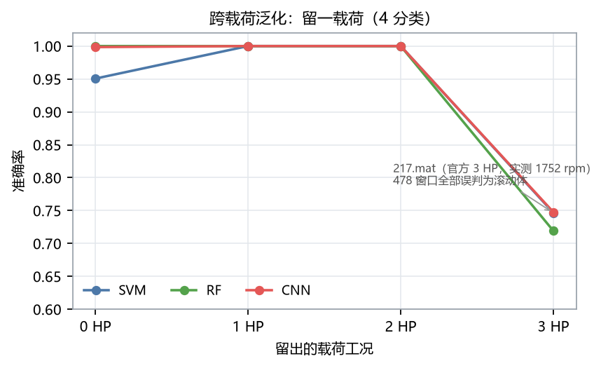

### 3.3 特征消融：物理阶次特征单独用最强

留一载荷、SVM、5 种子：

| 特征组 | 维度 | LOO 准确率 |
|---|---|---|
| 时域 | 12 | 0.829±0.166 |
| 时域+频域 | 22 | 0.910±0.094 |
| 全特征 | 48 | 0.924±0.105 |
| **仅包络阶次** | **26** | **0.993±0.007** |

反直觉但可解释：时域组的 RMS/峭度/峰值因子直接反映幅值，而幅值随载荷与传感器耦合变化。217.mat 的 RMS 0.760 超出全部内圈文件的上界（0.143–0.569），峭度 3.50 又低于全部内圈文件的下界（4.86–35.46），在时域特征空间里被推出内圈簇。**同一折上的直接对照**：仅用包络阶次特征时，217 的 461/478 个窗口被判成内圈（3 HP 折 acc 0.982）；加上时域特征后，478/478 全被判成滚动体（0.747）。包络阶次特征只看"在不在故障阶次上有调制"，不依赖绝对幅值，因此不受这个文件的幅值异常影响。

代价是：包络阶次特征依赖转速。转速未知或误差大时（例如变频工况、皮带打滑），这一组的优势会迅速消失——本项目所有实验都用了 `.mat` 里的实测 RPM。

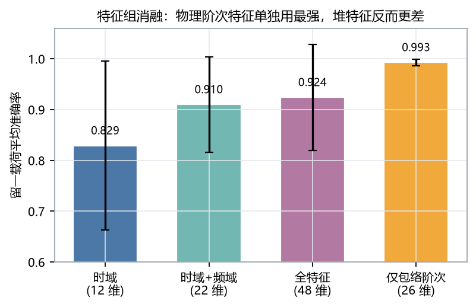

### 3.4 类型 × 损伤程度（10 分类）

| 协议 | SVM | 随机森林 |
|---|---|---|
| 随机切窗 | 1.000（类型 1.000） | 0.998（类型 0.999） |
| 时间块 | 0.998（类型 1.000） | 1.000（类型 1.000） |
| 留一载荷 | 0.907（类型 **0.921**） | 0.948（类型 **0.949**） |
| 留一载荷（剔 217） | 0.973 | 0.997 |

留一载荷下，10 分类比 4 分类低 2–4 个点；但"类型正确率"只低 1–1.5 个点——**错误主要是把尺寸判错，不是把部位判错**。逐折看，0 HP 折 SVM 0.895 是唯一非异常的低点（RF 0.9985），误差集中在 197.mat（外圈 0.014″）的少数窗口。

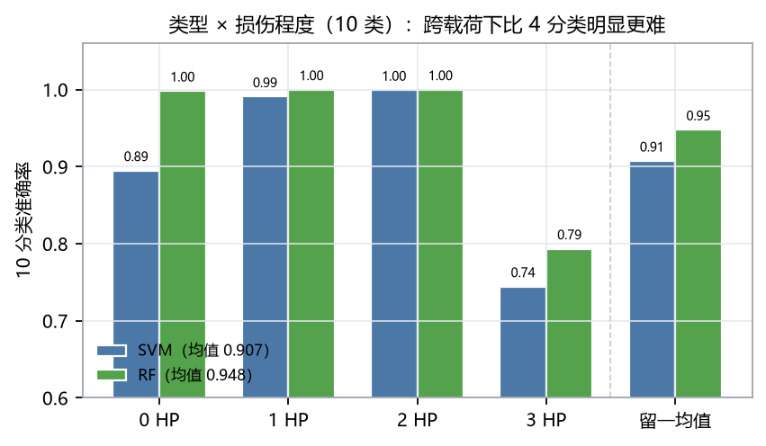

### 3.5 未见损伤程度：能外推，但模型差异极大

训练只用 0.007″/0.014″/0.021″，测试 0.028″（IR/B 两类，934 窗）：

| 模型 | IR/B 二分类准确率 | 预测分布 |
|---|---|---|
| SVM | **0.874** | IR 349 / B 585（无 Normal、无 OR） |
| 随机森林 | 0.493 | IR 921 / B 9（几乎全判内圈） |

RF 在这个口径上崩了：0.028″ 是训练分布之外的新尺寸，树的划分阈值在特征空间边缘外推能力差，把所有样本倒向样本量更大的一侧。SVM 的 RBF 核至少还能维持 0.87。这条结果对工程的含义是：**"能诊断已知尺寸"不等于"能诊断更严重的损伤"**，选模型时要专门测外推。

### 3.6 未见故障位置：真正的失效模式

训练外圈 6 点钟方向，测试 3 点/12 点方向（1883 窗，真值全为外圈）：

| 模型 | 判为 OR | 判为 B | 判为 IR |
|---|---|---|---|
| SVM | **0.266** | 0.545 | 0.189 |
| 随机森林 | **0.423** | 0.323 | 0.253 |

同一模型在跨载荷上是 0.99。位置一变，超过一半的外圈故障被当成滚动体。物理解释：外圈故障的冲击传递路径随缺陷位置改变，6 点钟方向位于承载区正下方，冲击直接经轴承座传出；3 点/12 点方向的冲击要绕经套圈与轴承座的不同路径，高频共振被滤波、幅值调制改变，谱结构与滚动体的"随机冲击 + 转频调制"更接近。

工程含义：外圈故障不能按"一个类"建模，位置是需要显式覆盖的域；数据采集时应覆盖多个方位，或做位置增广。

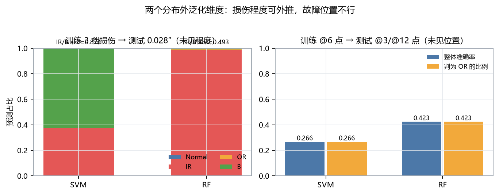

### 3.7 加噪鲁棒性：物理特征先崩

干净训练，测试加噪（不重训）：

| 测试 SNR | SVM（全特征） | SVM（仅包络阶次） | 1D-CNN |
|---|---|---|---|
| 干净 | 1.000 | 0.998 | 0.998 |
| 10 dB | 0.545 | 0.556 | **0.985** |
| 6 dB | 0.306 | 0.295 | **0.944** |
| 2 dB | 0.243 | 0.213 | 0.635 |
| 0 dB | 0.268 | 0.214 | 0.472 |
| −4 dB | 0.139 | 0.215 | 0.214 |

特征模型在 10 dB 就崩，不是"信号被淹没"——10 dB 下波形还看得很清楚。机制是**特征分布整体漂移**：加噪后谱熵从 0.849 升到 0.924（约 1.3 个标准差，且方差从 0.057 缩到 0.010，说明所有样本被推到同一侧），包络 BPFO 信噪比从 3.53 降到 2.71。SVM 只见过干净分布，RBF 核把这些样本甩到决策边界之外。

这条结论与本项目的主线相反，但必须写出来：**手工物理特征的优势在可解释性和小样本，不在噪声鲁棒性**。若现场信噪比低，应当做噪声增广训练，或者直接用 CNN。

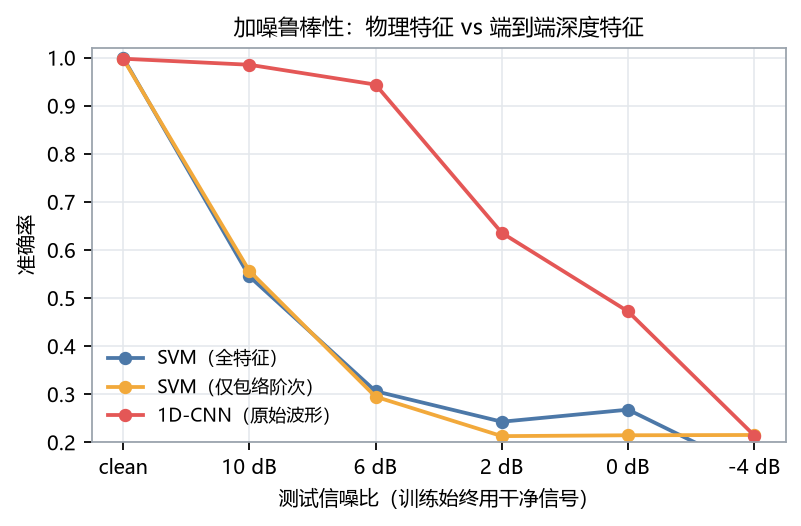

### 3.8 深化一：CNN 补齐分布外口径（`09_cnn_ood.py`）

v1.0 只在同工况 4 分类上跑了 CNN，位置/程度口径缺位（原 §5.5）。补齐后（CNN 均为 seed=0，10 分类时间块为 seed 0/1）：

| 口径 | SVM | RF | 1D-CNN | 备注 |
|---|---|---|---|---|
| 4 分类 · 留一载荷 | 0.924 | 0.930 | **0.936±0.109** | CNN 略优 |
| 4 分类 · 留一载荷（剔 217） | 0.987 | — | **0.999** | 3 HP 折 CNN 剔 217 后 1.000 |
| 4 分类 · 未见程度 0.028″（IR/B 二分类） | **0.874** | 0.493 | 0.500 | CNN **全判 IR**，外推塌陷 |
| 4 分类 · 未见位置 @3/@12 | 0.266 | 0.423 | **0.485** | 三者都不及格，CNN 略好 |
| 10 分类 · 时间块 | 0.998 | 0.9998 | 0.9988±0.0012 | 都饱和 |
| 10 分类 · 留一载荷 | 0.907 | **0.948** | 0.893 | 类型正确率 0.921 / 0.949 / **0.937** |
| 10 分类 · 留一载荷（剔 217） | 0.973 | 0.997 | 0.949 | |

三条要点：

1. **跨载荷口径上 CNN 与特征模型同量级**（0.936 vs 0.924/0.930），剔 217 后 CNN 0.999 是三者最高。217.mat 对三类模型是同一场灾难（CNN 3 HP 折 0.748，窗口全判滚动体/内圈）。
2. **未见损伤程度上 CNN 和 RF 一起塌，而且塌法不同**：SVM 0.874 还能部分外推；RF 0.493、CNN 0.500。CNN 的 934 个测试窗**全部判成 IR**（预测分布 {IR:934}）——0.028″ 的冲击形态对它来说落到了 IR 类的"最近邻"，端到端模型对超出训练范围的尺寸没有外推能力。原以为"特征外推差、深度模型好"，实际是两类模型都外推不了。
3. **位置偏移对 CNN 一样致命**：0.485，比 SVM 0.266、RF 0.423 好，但一半以上的外圈窗口仍被判成内圈（预测分布 IR:943 / OR:913 / B:27）。§4.2 的机制解释不变。

### 3.9 深化二：噪声增广训练，加噪崩溃可以救回来（`10_noise_aug.py`）

§3.7 的"特征模型先崩"只测了零适配（干净训练、带噪测试）。把训练集换成"每个 epoch 逐窗随机抽 SNR ∈ {干净, 10, 6, 2, 0, −4} dB 加噪"（CNN，`models.augment_noise`），SVM 则用干净 + 10/2/−4 dB 三个固定噪声副本的特征拼接训练（15328 行）。测试口径与 §3.7 完全相同：

| 测试 SNR | SVM_all 零适配 | **SVM_all 增广** | SVM_env 零适配 | SVM_env 增广 | CNN 零适配 | **CNN 增广** |
|---|---|---|---|---|---|---|
| 干净 | 1.000 | 1.000 | 0.998 | 0.985 | 0.998 | 0.997 |
| 10 dB | 0.545 | **1.000** | 0.556 | 0.947 | 0.985 | 0.997 |
| 6 dB | 0.306 | **1.000** | 0.295 | 0.899 | 0.944 | 0.997 |
| 2 dB | 0.243 | **0.999** | 0.213 | 0.884 | 0.635 | 0.997 |
| 0 dB | 0.268 | **0.998** | 0.214 | 0.880 | 0.472 | 0.997 |
| −4 dB | 0.139 | **0.990** | 0.215 | 0.807 | 0.214 | 0.997 |

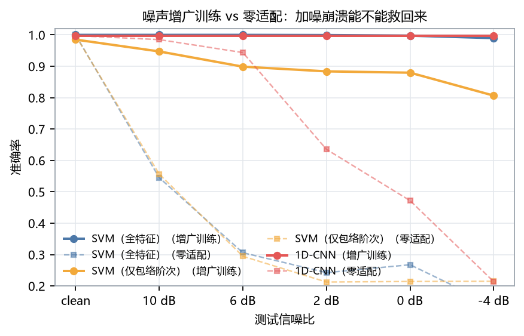

结论被**部分推翻**：

- 增广后的全特征 SVM 在整个 SNR 网格上 1.000→0.990，比 CNN 还稳（−4 dB 时两者 0.990 vs 0.997）。§3.7 的"手工特征噪声鲁棒性差"应修正为：**那是训练分布不覆盖的产物，不是特征方法的固有缺陷**。特征漂移（谱熵上移等）真实存在，但干净 + 3 个噪声副本的训练让 SVM 学会了漂移后的位置。
- CNN 增广后在所有 SNR 上准确率恒为 0.9973——预测完全不随测试 SNR 变化，表示学到了真正的噪声不变表示。
- 代价只有一点点：干净测试上 SVM_env 从 0.998 微降到 0.985。

一句话：**加噪场景下先做噪声增广，再谈选模型。**

### 3.10 深化三：位置 few-shot，48 个窗口就够（`11_position_fewshot.py`）

零样本位置泛化（§3.6）的结论不能外推成"位置一变就废"。协议：16 个目标文件（@3/@12）按时间排序，每文件前 10% 窗口作适配池、其后为**固定测试集**（1675 窗）；适配集取池内前 {0, 2.5, 5, 10}%（嵌套），并入主线训练。验证集只从主线文件切，适配窗口全部留在训练集。

| 适配比例 | 适配窗数 | SVM（全特征） | SVM（包络） | RF | CNN 重训 | **CNN 微调头** |
|---|---|---|---|---|---|---|
| 0（零样本） | 0 | 0.265 | 0.322 | 0.425 | 0.484 | 0.484 |
| 2.5%（≈3 窗/文件） | 48 | **0.998** | 0.989 | 0.999 | 0.556 | **1.000** |
| 5%（≈6 窗/文件） | 96 | 0.999 | 0.992 | 1.000 | 0.321 | **1.000** |
| 10%（≈12 窗/文件） | 192 | 0.999 | 0.996 | 1.000 | 0.475 | **1.000** |

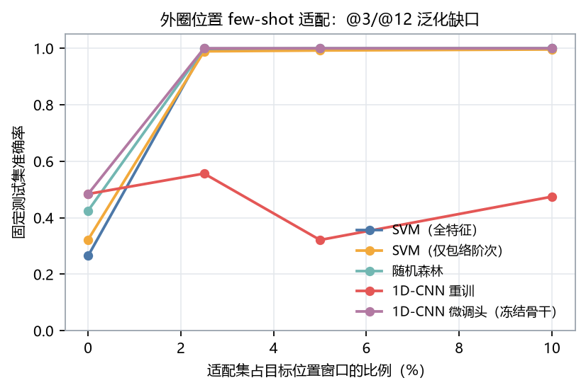

三条结论，最后一条最重要：

1. **特征模型的 few-shot 是立竿见影的**：48 个窗口（每文件 3 个，含 50% 重叠约 0.3 s 数据）把 SVM 从 0.265 拉到 0.998。传递路径变了，但目标工况的谱形一小段就能学到——不需要按位置分域建一堆模型。
2. **CNN 重训救不动，而且非单调**（0.556 → 0.321 → 0.475）。48–192 个目标窗口混进 3880 窗的训练集只占 1–5%，SGD 基本淹没了它们；加了样本也不保证走向正确。
3. **正确的姿势是冻结骨干、只微调分类头**（CNN_ft）：预训练一次主线模型，之后只用适配窗口重训 head，2.5% 起全部 1.000。深度模型的领域适配要动结构（冻结/微调），不是堆样本重训。

⚠️ 口径限定（§5.2）：这是"现场已就位、采一段数据做校准"的场景，不是对全新设备的冷启动泛化；测试集只有外圈类，准确率即 OR 召回率。

---

### 3.11 v1.2 深化四：217.mat 双口径系统化（`12_sensitivity_217.py`）

之前只有 SVM 的"剔 217 后均值"一列。现在把口径升级为：**凡测试集含 217 的场景，所有模型/特征组都给含/剔两套数字；217 在训练侧时另做污染与去混杂对照**。

**A 双口径主表**（测试集 = 3HP 折 / 单源 0→3；训练侧为 0/1/2，本身不含 217）：

| 场景 | 模型 | 含 217 | 剔 217 | Δ |
|---|---|---|---|---|
| LOO 第 3 折 | SVM 全特征 | 0.7466 | 0.9986 | −0.252 |
| LOO 第 3 折 | **SVM 仅包络** | **0.9820** | **0.9880** | **−0.006** |
| LOO 第 3 折 | RF 全特征 | 0.7191 | 0.9619 | −0.243 |
| LOO 第 3 折 | RF 仅包络 | 0.6832 | 0.9138 | −0.231 |
| LOO 第 3 折 | CNN | 0.7476 | 1.0000 | −0.252 |
| 单源 0→3 | SVM 全特征 | 0.7392 | 0.9887 | −0.250 |
| 单源 0→3 | SVM 仅包络 | 0.4842 | 0.6476 | −0.163 |
| 单源 0→3 | RF 全特征 | 0.7059 | 0.9442 | −0.238 |
| 单源 0→3 | RF 仅包络 | 0.4446 | 0.5911 | −0.147 |
| 单源 0→3 | CNN | 0.7043 | 0.9421 | −0.238 |

剔除后的四折均值（折 0/1/2 不含 217 不变，折 3 用剔除口径）：SVM (0.951+1.000+1.000+0.999)/4 = **0.987**、RF (1.000+1.000+1.000+0.962)/4 = **0.990**、CNN (0.999+1.000+1.000+1.000)/4 = **1.000**。

10 分类 LOO 第 3 折同步给两套：SVM 含 acc 0.7455/type 0.7460 → 剔 acc 0.9972/type 0.9979；RF 含 0.7455/0.7487 → 剔 0.9922/0.9965。**唯一对 217 免疫的配置是 SVM+仅包络特征（−0.006）**——与 §3.3 一致；但注意仅包络特征在单源 0→3 上本来就弱（剔 217 后 0.648 vs 全特征 0.989），"免疫"与"强"是两回事。

**B 训练污染（217 在训练侧）**：LOO 0/1/2 折（训练含 3HP）剔不剔 217 几乎无差（Δ=−0.006…0）；但**以 3HP 为源时，训练集含 217 反而大幅利好迁移**：3→0 +0.097、3→1 +0.070、3→2 +0.077。

**B3 去混杂**：217 有 478 窗（普通故障文件约 117 窗），"训练含 217"同时是"多 32% 数据"。四个条件分离数据量与多样性（SVM/RF 全特征）：

| 3→目标 | full（含 217 全部 478 窗） | capped116（217 只取 117 窗） | without（剔 217） | upsampled478（剔 217 重采样补量） |
|---|---|---|---|---|
| 3→0 | 0.948 / 0.941 | **0.986** / 0.932 | 0.852 / 0.849 | 0.851 / 0.848 |
| 3→1 | 0.992 / 0.893 | **0.997** / 0.893 | 0.922 / 0.828 | 0.922 / 0.830 |
| 3→2 | 1.000 / 0.963 | **1.000** / 0.964 | 0.923 / 0.899 | 0.923 / 0.903 |

结论清晰：**数据量不是原因**（upsample 与 without 全平）；**异常样本的"分布桥接"才是原因，且小剂量优于全量**——217 实测转速 1752 rpm（2HP 档）、谱形偏 BPFO，恰好补上 3HP 训练分布向低载荷/外圈侧的覆盖缺口；只给 117 窗时迁移收益最大（3→0 0.852→0.986），全量 478 窗反而回落到 0.948（错误标注的量大了会拉偏边界）。

**C 特征层证据**（217 vs 其余内圈文件，稳健 z 分数 top）：

| 特征 | z | 217 中位 | 同侪中位 |
|---|---|---|---|
| fd_band_0_1k | +77.8 | 910.4 | 102.0 |
| env_ftf_h1_rel | +21.6 | 0.079 | 0.006 |
| fd_centroid | −20.9 | 776 Hz | 2713 Hz |
| fd_rolloff85 | −15.9 | 814 Hz | 3727 Hz |
| env_bpfo_h1_snr | +9.9 | 5.47 | 3.50 |

低频能量 8 倍于同侪、谱重心压到 1/3、BPFO 信噪比反超——三个独立特征族同时指向"这不是一个常规内圈件"。预测分布：SVM 全特征 → B 100%；**RF 全特征 → Normal 100%**（与 SVM 的误判方向不同）；SVM 仅包络 → IR 96.4%（§3.3 的"救回"）；RF 仅包络 → B 83.7%。同一批窗口在不同模型里被判成三个不同类，说明它们处在特征空间的低密度区，而不是"像某一类"。

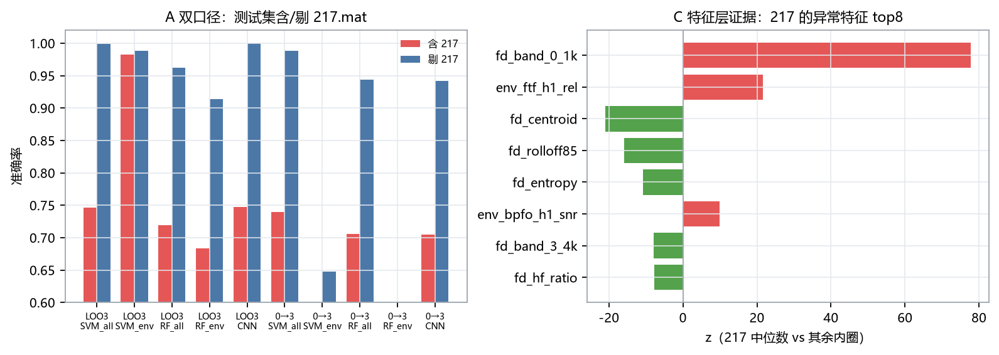

---

### 3.12 v1.2 深化五：迁移矩阵、源工况数量与载荷探针（`13_transfer_matrix.py`）

**A 4×4 有向迁移矩阵**（SVM，5 种子均值；对角为载荷内时间块参考；行=训练载荷、列=测试载荷）：

| 全特征 | 0HP | 1HP | 2HP | 3HP |
|---|---|---|---|---|
| **0HP** | 1.000 | 0.999 | 0.999 | 0.739 |
| **1HP** | 0.997 | 1.000 | 1.000 | 0.745 |
| **2HP** | 0.991 | 1.000 | 1.000 | 0.748 |
| **3HP** | 0.948 | 0.992 | 1.000 | 1.000 |

| 仅包络 | 0HP | 1HP | 2HP | 3HP |
|---|---|---|---|---|
| **0HP** | 0.994 | 0.833 | 0.817 | 0.484 |
| **1HP** | 0.986 | 0.995 | 0.988 | 0.725 |
| **2HP** | 0.983 | 0.999 | 1.000 | 0.730 |
| **3HP** | 0.991 | 0.995 | 0.991 | 0.996 |

RF 的矩阵形态相同（3→1 略低 0.908）；CNN 不对称抽查：0→3 = 0.704、3→0 = 0.801。三条结构：

1. **迁移不对称**：任意源 → 3HP 都掉到 0.70–0.75（217 在测试侧），但 3HP → 任意目标 ≥ 0.94。3HP 是"最难域"，在其上训练覆盖了其他载荷；反过来不行。
2. **仅包络特征的单源迁移很脆**：0→1 = 0.83、0→2 = 0.82、0→3 = 0.48。§3.3 的"仅包络最强"是**多源（LOO）口径**的结论，单源口径下全特征更稳（0→1/2 全特征 0.999）。
3. 相邻载荷（0↔1、1↔2、2↔3）互迁几乎无损，跨两档（0↔2、0↔3）才开始掉。

**B 源工况数量**（目标 3HP：源 = {0,1,2} 的全部 1/2/3 组合；目标 0HP 同理，SVM）：

- 目标 3HP：1 源均值 0.744、2 源 0.746、3 源 0.747 —— **完全平坦**。测试侧被 217 主导时，加源工况没有用。
- 目标 0HP：1 源均值 0.979、2 源 0.966、3 源 0.951 —— **反向单调**。加得越多反而越差，因为多加的 3HP 源带进 217（与 §3.11-B3 的"全量回落"同根因）；最优是只用最近的 1HP 源（0.997）。

**C 载荷信息残留探针**（RF 用特征预测载荷标签，时间块划分，机会水平 25%）：

| 特征组 | time | freq | env_only | all |
|---|---|---|---|---|
| 载荷探针准确率 | 0.645 | 0.840 | **0.771** | 0.895 |

仅包络特征仍能以 77% 解码载荷（机会 25%）；类内探针（全特征）：IR 0.999、OR 0.945、B 0.874、Normal 0.784。**§4.1 的"阶次化消掉载荷"只对了频率缩放这一半**——阶次归一化之后，幅值层级与调制结构仍强烈编码载荷。这解释了仅包络特征为什么单源迁移脆（0→3 = 0.48）而多源覆盖下强（LOO 0.993）：不是特征里没有载荷信息，而是多源训练把这条"载荷方向"学成了不变量。

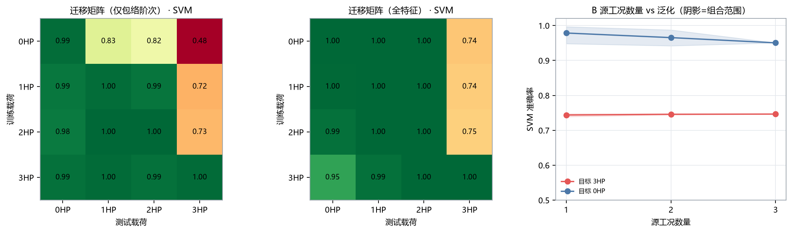

---

### 3.13 v1.2 深化六：10 分类序数口径 + 消融 × 协议（`14_10class_ordinal.py`）

**A 序数/分层指标**（把"错一档尺寸"与"错一个部位"分开记账）：

| 协议 | 模型 | 类型正确 | 尺寸对\|类型对 | ≤1 档\|类型对 | 平均\|Δ档\| |
|---|---|---|---|---|---|
| 时间块 | SVM | 1.0000 | 0.9982 | 1.0000 | 0.0018 |
| 时间块 | RF | 1.0000 | 1.0000 | 1.0000 | 0.0000 |
| 留一载荷 | SVM | 0.9207 | 0.9859 | 1.0000 | 0.0018 |
| 留一载荷 | RF | 0.9490 | 0.9988 | 1.0000 | 0.0003 |

两个新事实：**（a）尺寸从不跨档出错**（≤1 档比例 = 1.0000）——所有的尺寸错误都发生在相邻档（0.007↔0.014↔0.021）之间，不会把 0.007″ 判成 0.021″；**（b）LOO 的错误几乎全是部位错误**（217 贡献的 IR021 召回 SVM 0.424 / RF 0.544，其余类 ≥ 0.84），一旦部位判对，尺寸准确率 0.986–0.999。时间块下两类错误都接近零。

**B 消融 × 协议**（4 分类，与 §3.3 同任务；SVM / RF，5 种子）：

| 特征组 | 时间块 SVM | LOO SVM | 时间块 RF | LOO RF |
|---|---|---|---|---|
| time | 0.974 | 0.829 | 0.996 | **0.959** |
| freq | 0.995 | 0.914 | 0.997 | 0.916 |
| time+freq | 1.000 | 0.910 | 1.000 | 0.936 |
| env_only | 0.998 | **0.993** | 0.986 | 0.907 |
| all | 1.000 | 0.924 | 1.000 | 0.930 |

**"仅包络阶次最强"是 SVM 特有的**：RF 在 LOO 上时域特征反而最强（0.959），仅包络最弱（0.907）。机理差异：RBF-SVM 对幅值整体漂移敏感，被时域特征带偏（217 现象），阶次特征给了它一个平稳坐标系；树模型用阈值切分，幅值层级本身就是可利用的跨载荷序结构（RMS 随载荷单调），删掉时域等于扔掉这条线索。另外时间块下所有特征组都在 0.97 以上——组间差异只在跨载荷口径才拉开，这本身就是"同工况比不出方法"的又一证据。

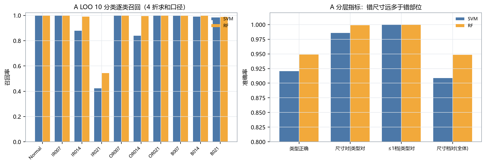
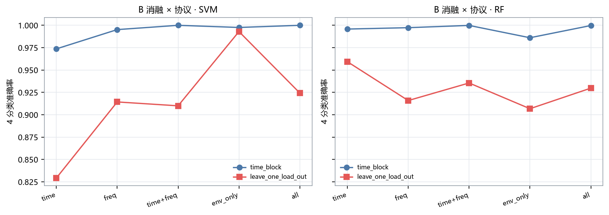

---

## 4 讨论

### 4.1 为什么跨载荷几乎不掉点

因为故障特征频率随转速线性缩放，而包络阶次特征用实测 RPM 做了归一化。载荷变化带来的主要是转速（1797→1730 rpm，−3.7%）与幅值变化，前者被阶次化消掉，后者被标准化与核方法吸收。这也是为什么"仅包络阶次"在跨载荷上最强。

反过来，如果特征用固定频率点（例如直接取 3.5 kHz 带能量），跨载荷会明显退化——很多文献的"跨工况掉点"来自这里。

**v1.2 修正（§3.12-C）**：阶次化消掉的只是频率缩放这一半。载荷探针显示仅包络特征里仍能以 77% 准确率解码载荷标签（机会 25%，全特征 89%）——幅值层级与调制结构仍强烈编码载荷。所以"仅包络特征抗载荷"的真正机理是：多源（LOO）训练把载荷方向学成了不变量，而不是特征里没有载荷信息。单源迁移（0→3 = 0.48）会立刻暴露这一点。

### 4.2 为什么位置变化这么致命

外圈缺陷位置决定冲击到传感器的传递函数。6 点钟在承载区正下方，冲击路径最短、高频成分保留最多；3 点/12 点要绕行，高频被衰减，包络谱的形状和幅值都变。模型学到的"外圈 = 某个谱形"，在换位置后失效。

这不是模型容量问题：1D-CNN 也只到 0.485（§3.8），端到端学到的同样是"6 点钟谱形 = 外圈"。不过深化实验（§3.10）显示这不是死结：给 10%（约 1.2 秒）目标位置窗口做适配，所有模型都能回到 0.99+。

### 4.3 4 分类为什么不该再用来比方法

6246 个窗口、4 个类、类间差异是"有无周期冲击"这种量级，任何像样的特征都能分开。同工况 100%、跨载荷 99%，剩下的差异全在个别文件上。继续在这个口径上调模型，边际收益接近 0。

### 4.4 217.mat 该怎么处理

保留、标注、做敏感性对照，而不是悄悄删掉。理由：

- 它是官方表格里 `IR021_3` 对应的文件，删掉就等于改了数据集定义；
- 它的 rpm 与同工况不符，很可能本身就是官方的一次替换/勘误，别人的复现也会遇到；
- 报告里同时给"含 217"和"剔 217"两套数字，读者可以自己判断。

---

## 5 局限与负结果

### 5.1 数据质量：217.mat 与工况不匹配

| 项 | 217.mat | 同为 3 HP 的其他文件 | 同尺寸 211.mat（2 HP） |
|---|---|---|---|
| 转速 | **1752 rpm** | 1721、1728 rpm | 1752 rpm |
| 时长 | **41.0 s** | 10.1–10.2 s | 10.2 s |
| RMS | **0.760** | 0.065–0.711 | 0.488 |
| 峭度 | **3.50** | 2.57–36.0 | 7.98 |
| BPFI − BPFO | **−0.63** | 全部内圈文件 −0.16…+2.47 | +1.82 |
| 4 分类预测 | **478/478 → 滚动体** | 正确 | 正确 |

四条独立证据指向同一件事：转速属于 2 HP 档、时长是其余的 4 倍、幅值与冲击性都偏离内圈全体、包络谱以 BPFO 为主（内圈故障应 BPFI 主导）。最可能的解释是官方在某个时间点替换过该文件（旧清单里 `IR021_3` 常写作 212.mat），而当前表格指向 217。

**影响与处理**：保留在数据集里（它就是官方文件），在报告中同时给含/剔两套数字。它不影响"包络阶次特征有效"的结论——仅用包络阶次特征时该文件 96.4% 的窗口仍被判对内圈。

**v1.2 补充（§3.11）**：双口径已系统化——LOO 第 3 折 SVM 全特征 0.747→0.999（剔后）、CNN 0.748→1.000，10 分类同步给两套。训练侧视角更微妙：217 作为测试样本是 −25 点的灾难，但作为训练样本是小剂量的分布桥接（3→0 从 0.852 到 0.986），且**剂量敏感**——只取 117 窗时收益最大，全量 478 窗反而回落（0.948）。数据量不是原因（重采样补量无效），是它的"低载荷 + BPFO 谱形"补了 3HP 训练分布的覆盖缺口。工程含义：现场遇到标注可疑的文件，不要直接删——测试集里隔离标注，训练集里按小剂量用。

### 5.2 位置 few-shot 的口径限定（见 §3.10）

few-shot 适配的测试集是**同一批文件的较晚时间段**（每文件前 10% 切出适配池，其后为测试），且窗口 50% 重叠。它回答的是"现场已就位、采一段数据做校准"的场景，**不是**"对全新设备的冷启动泛化"。后者仍需要跨设备实验（§5.5）。另外测试集只有外圈类（位置子集全部是 OR），准确率即 OR 召回率，与 05 脚本同口径。

### 5.3 噪声增广只做了高斯白噪声

§3.9 的增广与测试都只覆盖加性高斯白噪声。真实现场噪声有色（转速谐波、结构共振、电磁干扰），增广收益不能照搬。另外 SVM 的增广用了 3 个固定噪声副本（非逐窗随机 SNR），CNN 才是每 epoch 重抽；两者公平性不完全对等。

### 5.4 已修复的两个实现坑（会影响结论，故记录）

1. **包络带内无 bin → 特征恒 0。** 最初用 1024 点窗、±2% 带宽，Δf=11.7 Hz 而 BPFI 的 ±2% 只有 ±3.2 Hz，多个文件 `env_bpfi_h1_snr` 恒为 0（看起来像"这批数据没有内圈特征"）。改为"带宽 ≥ 1 个频率分辨单元"并把窗长提到 2048 后消失。
2. **特征缓存键不含数据集规模。** `features_*.npz` 只按窗口长度命名，先跑主线（6246 窗）再跑全量（9063 窗）会读到旧缓存，掩码维度对不上才报错；若维度恰好相同会静默出错。已在键里加入窗口数。

### 5.5 未做的

- 未做跨设备迁移（CWRU → Paderborn/JNU），这是比跨载荷更真实的域偏移；
- 未做变转速（升/降速）工况，阶次特征在那种场景需要重采样/角域同步；
- 噪声类型只有高斯白噪声（见 §5.3）；未见程度的外推实验只测了 0.028″ 一个点。

### 5.6 v1.2 的口径限定

- **B3 去混杂只扫了一个剂量点**（117 窗 vs 478 窗），"小剂量最优"的完整剂量曲线未做；upsample 对照用的是有放回重复采样，只排除了"数据量"，不排除"数据多样性"的其他形式（例如从 Paderborn 借真实新样本）。
- **载荷探针只用了 RF(n=200)**，解码准确率是"载荷信息可解码性"的下界估计，不是信息论度量；时间块划分避免了重叠泄漏，但探针口径回答的是"特征里有没有载荷信息"，不是"模型会不会利用它"。
- **迁移矩阵的对角线是载荷内时间块参考**（30% 测试），与非对角的"全量跨载荷"口径略有差异，比较时以非对角为主。

---

## 6 复现

```bash
pip install -r requirements.txt
python scripts/00_download_data.py --workers 10   # 64 文件 / 208 MB，约 20 分钟
python scripts/01_eda.py --roles main
python scripts/02_train_classical.py
python scripts/03_train_cnn.py
python scripts/04_cross_load.py --cnn-seeds 1 --cnn-epochs 20
python scripts/05_ablation_position_severity.py
python scripts/07_severity_10class.py
python scripts/08_noise_robustness.py
python scripts/09_cnn_ood.py          # 深化：CNN 分布外口径
python scripts/10_noise_aug.py        # 深化：噪声增广训练
python scripts/11_position_fewshot.py # 深化：位置 few-shot 适配
python scripts/12_sensitivity_217.py  # v1.2：217.mat 双口径 + 训练污染 + 去混杂
python scripts/13_transfer_matrix.py  # v1.2：迁移矩阵 + 源数量 + 载荷探针
python scripts/14_10class_ordinal.py  # v1.2：10 分类序数口径 + 消融×协议
python scripts/06_make_figures.py
```

或 `bash run_all.sh`。测试：`pytest tests -q`（30 项，不依赖数据集）。

单文件诊断演示：

```bash
python tools/predict.py 105.mat
```

---

## 附录 A 指标出处

| 结论 | 文件 |
|---|---|
| 同工况 / 泄漏差 | `results/metrics/classical_{random_window,time_block}.json`、`cnn_*.json`、`leakage_gap.json` |
| 跨载荷 | `results/metrics/cross_load.json`（含 `per_file_diagnostic`、`sensitivity_excl_217`） |
| 单源 0→3 | `results/metrics/cross_load_0_to_3.json` |
| 特征消融 | `results/metrics/ablation_features.json` |
| 10 分类 | `results/metrics/severity_10class.json` |
| 未见程度 / 位置 | `results/metrics/severity_extrapolation.json`、`position_generalization.json` |
| 加噪 | `results/metrics/noise_robustness.json` |
| CNN 分布外口径 | `results/metrics/cnn_ood.json` |
| 噪声增广 | `results/metrics/noise_augmented.json` |
| 位置 few-shot | `results/metrics/position_fewshot.json` |
| 217 双口径/训练污染/去混杂 | `results/metrics/sensitivity_217.json` |
| 迁移矩阵/源数量/载荷探针 | `results/metrics/transfer_matrix.json` |
| 10 分类序数/消融×协议 | `results/metrics/10class_ordinal_ablation.json` |
| 数据校验 | `results/metrics/download_log.json`（64 文件 sha256 + MATLAB 头） |

## 附录 B 数据集文件与坑

- 官方表格：`12k-drive-end-bearing-fault-data`。**`IR021_3` 是 217.mat，不是 212.mat**（212 也存在，但表格指向 217）。
- 外圈 12 点方向 0.007″ 的 1 HP 文件是 **158.mat**（157 未被列出）。
- `OR014@3`、`OR014@12`、全部 `OR028` 官方缺失（表格里是 `*`）。
- 完整映射见 `configs/cwru_manifest.csv`（64 行，逐行对照官方表格生成）。
